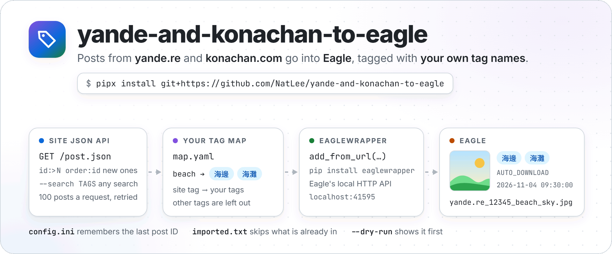
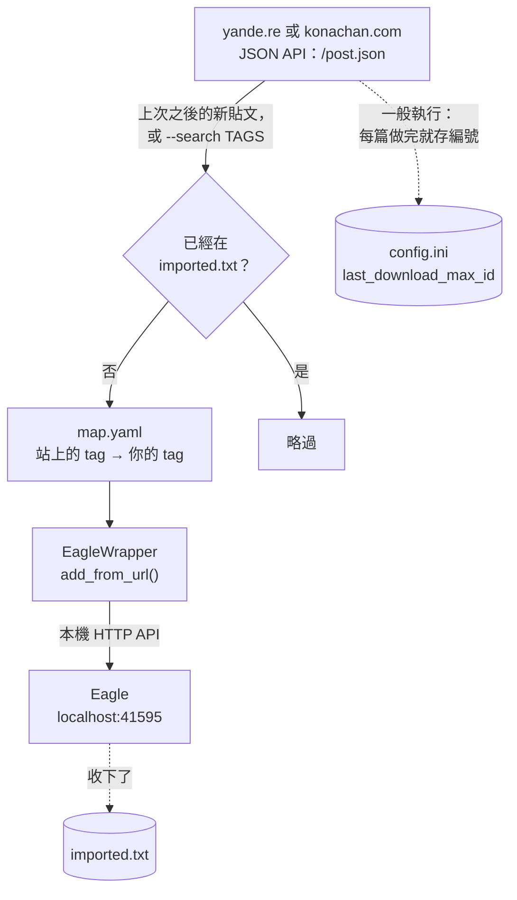

<p align="center">
  <picture>
    <source media="(prefers-color-scheme: dark)" srcset="https://raw.githubusercontent.com/NatLee/yande-and-konachan-to-eagle/main/docs/images/hero-dark.png">
    
  </picture>
</p>

<p align="center">
  <a href="https://github.com/NatLee/yande-and-konachan-to-eagle/actions/workflows/test.yml"></a>
  <a href="pyproject.toml"></a>
  <a href="https://pypi.org/project/EagleWrapper/"></a>
</p>

[English](README.md) | [繁體中文](README.TW.md)

把 [yande.re](https://yande.re) 和 [konachan.com](https://konachan.com) 上的圖收進圖片管理軟體
[Eagle](https://eagle.cool/)，而且 tag 是你自己取的名字。工具會向網站要新的貼文（或你指定的搜尋結果），用一份小小的 YAML
對應表把站上的英文 tag 換成你的 tag，再把每張圖交給 Eagle，由 Eagle 下載進你的圖庫。它會記得上次做到哪裡、略過已經有的圖，
也可以先用 `--dry-run` 看看會匯入什麼。和 Eagle 溝通的部分是 [EagleWrapper](#這個工具是用-eaglewrapper-做的)，
你自己寫 Eagle 腳本時也能用。

> 注意：這兩個站都有成人內容。不加條件直接執行時，會匯入所有分級，和以前一樣。只想要全年齡的圖，
> 搜尋時加上 `rating:s`（見[範例](#範例)）。

## 運作方式



1. 網站的 JSON API 一次給 100 篇：一般執行時是上次之後的所有新貼文，從舊到新；用 `--search` 時是搜尋結果，從新到舊。
   每兩次請求之間停 1 秒，網站忙碌或連線不穩時會自動重試。
2. 列在 `imported.txt` 裡的貼文會略過，同一張圖不會進 Eagle 兩次。
3. `map.yaml` 把站上的 tag 換成你的 tag，不在對應表裡的 tag 不會加。
4. EagleWrapper 把圖片網址、名稱、tags 和註解送到 Eagle 的本機 HTTP API，由 Eagle 自己下載檔案。

## 安裝

需要 Python 3.9 以上，而且 Eagle 要開著（在同一台電腦，或另一台電腦，見[Eagle 在另一台電腦](#eagle-在另一台電腦)）。

```bash
pipx install git+https://github.com/NatLee/yande-and-konachan-to-eagle
```

[pipx](https://pipx.pypa.io/) 會把命令列工具裝在獨立的環境裡。裝好後有 `yande-and-konachan-to-eagle` 指令，
也可以用短名 `yk2eagle`。用 `pip install git+https://github.com/NatLee/yande-and-konachan-to-eagle` 也可以。

從原始碼執行，2023 年的用法照樣能用：

```bash
git clone https://github.com/NatLee/yande-and-konachan-to-eagle
cd yande-and-konachan-to-eagle
pip install -r requirements.txt
python main.py --help
```

## 快速上手

打開 Eagle，找一個工作資料夾，先預覽會匯入什麼：

```bash
yande-and-konachan-to-eagle --target yande --dry-run --limit 5
```

```text
INFO     No config file at ./config.ini: using the defaults (dry run, nothing written).
INFO     No tag map at map.yaml: using the example map (dry run, nothing written).
INFO     Last download Max. ID: 0
#1 [s] yande.re_1_beach_sky.jpg -> 海邊, 海灘
#2 [s] yande.re_2_autumn_bicycle.jpg -> 秋天, 腳踏車
#3 [s] yande.re_3_apple.jpg -> 蘋果
#4 [s] yande.re_4_bear_forest.jpg -> 熊
#5 [s] yande.re_5_long_hair.jpg -> (no tags from the map)
Post ID 5: 100%|██████████| 5/5 [00:00<00:00, 651.75post/s]
INFO     Dry run: 5 would be added to Eagle, 0 already imported, 0 without a file. Nothing was sent to Eagle and no file was written.
```

每一行依序是貼文編號、分級（`s` 全年齡、`q` 有點擦邊、`e` 成人）、在 Eagle 裡的名稱，以及從對應表得到的 tag。
沒問題的話，拿掉 `--dry-run`：

```bash
yande-and-konachan-to-eagle --target yande --limit 5
```

```text
WARNING  Path [./config.ini] does not exist!
WARNING  Creating default config file to the specific path!
Default content of the config:
----
[yande]
site = https://yande.re
last_download_max_id = 0
[konachan]
site = https://konachan.com
last_download_max_id = 0

----

WARNING  Path [map.yaml] does not exist! Created it from the example map: edit it to give the images your own tags.
INFO     Eagle 4.0.0 (build 20260327) at http://localhost:41595
INFO     Last download Max. ID: 0
Post ID 5: 100%|██████████| 5/5 [00:00<00:00, 68.13post/s]
INFO     Done: 5 added to Eagle, 0 already imported, 0 without a file, 0 refused by Eagle.
```

（上面兩段輸出是對 [`tests/fakes.py`](tests/fakes.py) 裡的假網站和假 Eagle 跑出來的，所以貼文和 Eagle 版本都是編的。
進度條會在原地更新，這裡只列出最後的樣子。）

第一次執行會在目前的資料夾建立 `config.ini` 和 `map.yaml`。編輯 `map.yaml`，把 tag 改成你習慣的名字。
之後再跑同一個指令，會從上次處理到的貼文接著做。新的 `config.ini` 從編號 0 開始，所以第一次執行如果不加 `--limit`，
會把整個站從頭跑一遍；只想要接下來的新圖，就把 `config.ini` 的 `last_download_max_id` 改成最近的貼文編號。

## 範例

```bash
# 全年齡的海邊圖，最新的 20 張，放進 Eagle 的「Beach」資料夾（沒有就建立）
yande-and-konachan-to-eagle --target yande --search "beach rating:s" --limit 20 --folder Beach

# 評分最高的風景圖，不是最新的：網站看得懂的搜尋都能用
yande-and-konachan-to-eagle --target yande --search "landscape order:score" --limit 50

# 再匯入一次某一篇，例如之前被 Eagle 拒收的
yande-and-konachan-to-eagle --target yande --search id:12345

# 每個站分開設定，各自有進度、對應表和匯入紀錄
yande-and-konachan-to-eagle --target konachan --config_path ~/eagle-import/konachan.ini --yaml_path ~/eagle-import/map.yaml
```

`--search` 的寫法和網站的搜尋框一樣：tag、`rating:s`、`order:score`、`id:12345`，或是用 `-tag` 排除某個 tag。

### Eagle 在另一台電腦

從其他裝置呼叫 Eagle 時，需要 Eagle 的 API 權杖（在 Eagle 的「偏好設定 › Developer」）。把權杖放進環境變數
`EAGLE_API_TOKEN`（EagleWrapper 會從這裡讀），再指定那台電腦的位址：

```bash
export EAGLE_API_TOKEN=your-token-here
yande-and-konachan-to-eagle --target yande --eagle-url http://192.168.1.20:41595
```

## 選項

```text
usage: yande-and-konachan-to-eagle [-h] [--config_path CONFIG_PATH] [--yaml_path YAML_PATH]
                                   [--target {yande,konachan}] [--search TAGS] [--limit N]
                                   [--folder NAME] [--dry-run] [--history-path PATH]
                                   [--eagle-url EAGLE_URL] [--version]
```

| 選項 | 用途 | 預設 |
|---|---|---|
| `--config_path` | 設定檔的位置，沒有就用預設值建立 | `./config.ini` |
| `--yaml_path` | tag 對應表的位置，沒有就從範例建立 | `map.yaml` |
| `--target` | 要抓哪個站：`yande` 或 `konachan` | `konachan` |
| `--search TAGS` | 改成匯入搜尋結果（從新到舊），寫法和網站的搜尋框一樣 | 不搜尋，匯入新貼文 |
| `--limit N` | 最多看 N 篇（已經匯入過的也算） | 不限 |
| `--folder NAME` | 放進這個 Eagle 資料夾（名稱或 ID，子資料夾也找；沒有就建立） | 不放資料夾 |
| `--dry-run` | 只列出會匯入什麼：不連 Eagle，也不寫任何檔案 | 關 |
| `--history-path` | 已匯入紀錄的位置 | 設定檔旁邊的 `imported.txt` |
| `--eagle-url` | Eagle 的位址；另一台電腦時也要設 `EAGLE_API_TOKEN` | `http://localhost:41595` |
| `--version` | 顯示版本 | |

前三個選項的名稱和預設值和 2023 年的版本一樣。完整說明用 `yande-and-konachan-to-eagle --help` 查看。

## tag 對應表

`map.yaml` 列出站上的 tag，以及你想在 Eagle 裡看到的 tag。第一次執行時會複製一份[範例對應表](src/yk2eagle/map.example.yaml)，
裡面有幾十個常見 tag 的中文名稱，你可以往上加：

```yaml
beach:
- 海邊
- 海灘
miko: 巫女服      # 只有一個 tag 時可以不寫成清單
animal_ears:
- 獸耳
```

只有對應表裡有的 tag 會進 Eagle。網站上的 tag 比範例多很多，想要的就自己加上去。tag 名稱就是網站上的寫法（看貼文的 tag 清單）。

## 匯入到 Eagle 的內容

| Eagle 欄位 | 內容 | 例子 |
|---|---|---|
| 名稱 | 圖片網址最後的檔名，空格換成底線 | `yande.re_12345_beach_sky.jpg` |
| 標籤 | 用 `map.yaml` 換過的 tag | `海邊`、`海灘` |
| 網址 | 圖片網址 | `https://files.yande.re/image/…/yande.re%2012345%20beach%20sky.jpg` |
| 註解 | `AUTO_DOWNLOAD`、加入的時間，以及貼文的原始出處（有的話） | `AUTO_DOWNLOAD`<br>`2026-11-04 09:30:00.123456`<br>`https://example.com/art/1` |
| 資料夾 | `--folder` 指定的資料夾，沒指定就不放 | `Beach` |

這些和 2023 年的版本送的一樣，新舊匯入的圖在 Eagle 裡看起來一致。

## 會留下的檔案

| 檔案 | 內容 | 說明 |
|---|---|---|
| `config.ini`（`--config_path`） | 每個站的網址，以及 `last_download_max_id`：一般執行最後處理到的貼文 | 沒有就用預設值建立；每篇做完就存，按 Ctrl+C 也不會丟進度 |
| `map.yaml`（`--yaml_path`） | 你的 tag 對應表 | 沒有就從範例建立 |
| `imported.txt`（`--history-path`，預設在設定檔旁邊） | 每篇被 Eagle 收下的貼文一行：`<站名> <貼文編號>` | 刪掉某一行，那篇就能再匯入一次 |

`--dry-run` 會讀這些檔案，但不會寫入。

## 出問題時

工具會停下來，用一行字說明發生什麼事。在那之前的進度都已經存好。

| 訊息開頭 | 意思 | 怎麼辦 |
|---|---|---|
| `Eagle is not answering at http://localhost:41595` | Eagle 沒開，或在別的位址 | 打開 Eagle；或用 `--eagle-url`；或先用不需要 Eagle 的 `--dry-run` |
| `https://konachan.com turned the request away with a "check your browser" page` | 網站的機器人檢查（Cloudflare）目前不讓你的網路用程式存取。2026 年 11 月我們連 konachan.com 時就遇到 | 晚點再試，或換個網路。工具不會嘗試繞過這類檢查 |
| `... still says "too many requests" (HTTP 429)` | 網站要你放慢速度，工具等過也重試過了 | 等一陣子再跑 |
| `Cannot reach https://yande.re` | 沒有網路，或 `config.ini` 裡的 `site` 位址寫錯 | 檢查網路和位址 |
| `Eagle refused: #123`（在最後） | Eagle 沒收下那張圖，例如不支援的檔案 | 原因記在上面幾行；用 `--search id:123` 重試 |
| `Cannot read the tag map map.yaml` | YAML 寫壞了，或不是對應表的格式 | 訊息會說明哪裡不對；見 [tag 對應表](#tag-對應表) |

## 這個工具是用 EagleWrapper 做的

工具裡所有和 Eagle 溝通的部分，都是 [EagleWrapper](https://github.com/NatLee/eagle-wrapper)
（[PyPI](https://pypi.org/project/EagleWrapper/)）。它是呼叫 Eagle 本機 HTTP API 的 Python 套件：支援傳統的 V1 API、
新的 Web API V2，還能在 Eagle 沒開時直接讀圖庫資料夾。如果你也有想用 Eagle 做的事（抓別的網站、整理 tag、備份），
一行 `pip install` 就能開始：

```bash
pip install eaglewrapper
```

```python
from eaglewrapper import Eagle, EagleAPIError, EagleConnectionError

eagle = Eagle(raise_errors=True)  # Eagle on this computer, http://localhost:41595
try:
    folder = eagle.create_folder('From Python')
    eagle.add_from_url('https://example.com/cat.jpg', 'cat.jpg', ['貓', '動物'],
                       website='https://example.com/cat', annotation='added from Python',
                       folder_id=folder['id'])
    print('Added to', folder['name'])
except EagleConnectionError:
    print('Is Eagle open?')
except EagleAPIError as e:
    print('Eagle said no:', e.message)
```

這個工具處理每篇貼文時，呼叫的就是這個 `add_from_url`（[`importer.py`](src/yk2eagle/importer.py)）。
Eagle 4.0 Build 21 以後還能用 Web API V2：`eagle.v2.item.query('beach OR sky')` 全文搜尋、合併 tag、智慧型資料夾、AI 搜尋。
完整功能見 [EagleWrapper 的 README](https://github.com/NatLee/eagle-wrapper#readme)。

## 從 2023 年的版本升級

呼叫方式不用改：`--config_path`、`--yaml_path`、`--target` 的名稱和預設值都一樣，`python main.py` 照樣能用，
`config.ini` 會從同一個貼文編號接著做。你會注意到的差別：

- 貼文改從網站的 JSON API 拿，一次 100 篇，不再一個編號抓一次網頁。快很多，對網站的負擔也小很多；進到 Eagle 的內容和以前一樣。
- 出問題時是一行清楚的說明，不再是一大段 traceback。被 Eagle 拒收的貼文會列在最後，以前是默默不見。
- 找不到 `map.yaml` 時會從範例建立。範例搬到了 [`src/yk2eagle/map.example.yaml`](src/yk2eagle/map.example.yaml)。
- 新選項：`--search`、`--limit`、`--folder`、`--dry-run`、`--history-path`、`--eagle-url`、`--version`，以及 `imported.txt` 匯入紀錄。
- EagleWrapper 從 1.1.1 換成 2.x，`pip install -r requirements.txt` 會一併處理。

## 開發

測試會在本機的隨機 port 起一個假網站和一個假 Eagle，所以不需要網路，也不需要 Eagle。

```bash
pip install -e . pytest
pytest
```

| 檔案 | 用途 |
|---|---|
| `src/yk2eagle/cli.py` | 命令列：選項、訊息、結束代碼 |
| `src/yk2eagle/moebooru.py` | 從網站的 JSON API 讀貼文：分頁、重試、請求之間的間隔 |
| `src/yk2eagle/tag_manager.py` | 讀 `map.yaml`、對應 tag |
| `src/yk2eagle/importer.py` | 透過 EagleWrapper 把每篇交給 Eagle；`--folder`、`--dry-run`、匯入紀錄 |
| `src/yk2eagle/config.py`、`history.py` | `config.ini` 和 `imported.txt` |
| `main.py` | 從原始碼執行同一個指令 |

## Contributor

<!-- ALL-CONTRIBUTORS-LIST:START - Do not remove or modify this section -->
<!-- prettier-ignore-start -->
<!-- markdownlint-disable -->
<table>
  <tbody>
    <tr>
      <td align="center"><a href="https://github.com/NatLee"><br /><sub><b>Nat Lee</b></sub></a></td>
    </tr>
  </tbody>
</table>

<!-- markdownlint-restore -->
<!-- prettier-ignore-end -->

<!-- ALL-CONTRIBUTORS-LIST:END -->

## 授權

[MIT](LICENSE)
