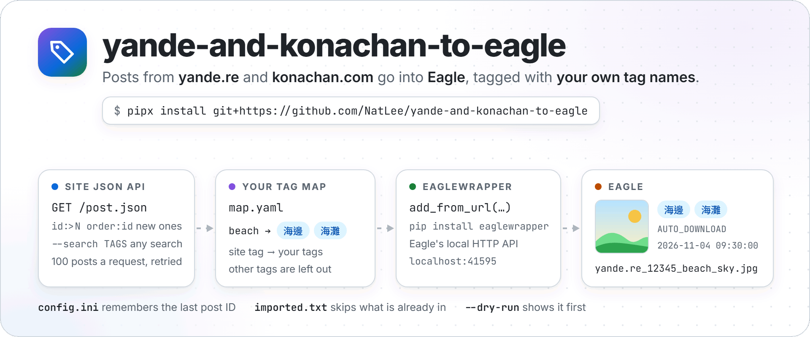
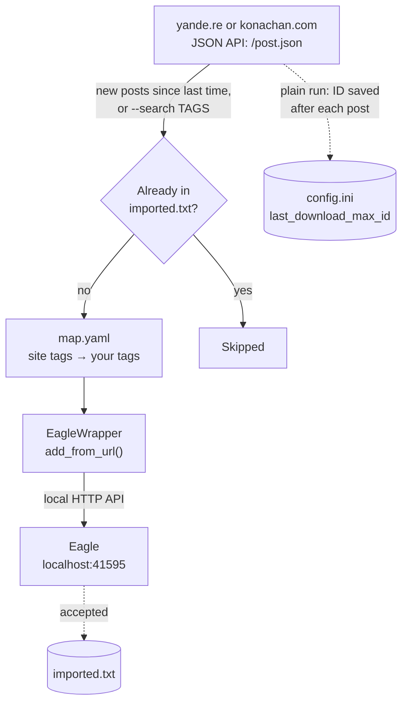

<p align="center">
  <picture>
    <source media="(prefers-color-scheme: dark)" srcset="https://raw.githubusercontent.com/NatLee/yande-and-konachan-to-eagle/main/docs/images/hero-dark.png">
    
  </picture>
</p>

<p align="center">
  <a href="https://github.com/NatLee/yande-and-konachan-to-eagle/actions/workflows/test.yml"></a>
  <a href="pyproject.toml"></a>
  <a href="https://pypi.org/project/EagleWrapper/"></a>
  <a href="LICENSE"></a>
</p>

[English](README.md) | [繁體中文](README.TW.md)

Collect images from [yande.re](https://yande.re) and [konachan.com](https://konachan.com) in
[Eagle](https://eagle.cool/), the image organiser, without the tag chaos. The tool asks the site for new posts
(or for a search you give it), turns the site's English tags into your own tags with a small YAML map, and hands
each image to Eagle, which downloads it into your library. It remembers where it stopped, skips what you already
have, and can show you everything first with `--dry-run`. The Eagle side is
[EagleWrapper](#built-with-eaglewrapper), a Python package you can use for your own Eagle scripts too.

> Heads-up: both sites host adult content. A plain run imports every rating, as it always has. To stay
> safe-for-work, search with `rating:s` (see [Examples](#examples)).

## How it works



1. The site's JSON API sends 100 posts per request: everything newer than the last run, oldest first, or the
   results of `--search`, newest first. There is a one-second pause between requests, and busy or flaky answers
   are retried.
2. Posts listed in `imported.txt` are skipped, so nothing lands in Eagle twice.
3. `map.yaml` turns the site tags into yours. Tags that are not in the map are left out.
4. EagleWrapper sends the image address, name, tags and a note to Eagle's local HTTP API. Eagle downloads the
   file itself.

## Install

You need Python 3.9 or later, and Eagle running on the same computer (or on another one, see
[Eagle on another computer](#eagle-on-another-computer)).

```bash
pipx install git+https://github.com/NatLee/yande-and-konachan-to-eagle
```

[pipx](https://pipx.pypa.io/) installs command-line tools in their own environment. You get the
`yande-and-konachan-to-eagle` command, and `yk2eagle` as a short name for it. `pip install
git+https://github.com/NatLee/yande-and-konachan-to-eagle` works too.

From a checkout, the 2023 way still works:

```bash
git clone https://github.com/NatLee/yande-and-konachan-to-eagle
cd yande-and-konachan-to-eagle
pip install -r requirements.txt
python main.py --help
```

## Quick start

Open Eagle, pick a working folder, and preview what the tool would import:

```bash
yande-and-konachan-to-eagle --target yande --dry-run --limit 5
```

```text
INFO     No config file at ./config.ini: using the defaults (dry run, nothing written).
INFO     No tag map at map.yaml: using the example map (dry run, nothing written).
INFO     Last download Max. ID: 0
#1 [s] yande.re_1_beach_sky.jpg -> 海邊, 海灘
#2 [s] yande.re_2_autumn_bicycle.jpg -> 秋天, 腳踏車
#3 [s] yande.re_3_apple.jpg -> 蘋果
#4 [s] yande.re_4_bear_forest.jpg -> 熊
#5 [s] yande.re_5_long_hair.jpg -> (no tags from the map)
Post ID 5: 100%|██████████| 5/5 [00:00<00:00, 651.75post/s]
INFO     Dry run: 5 would be added to Eagle, 0 already imported, 0 without a file. Nothing was sent to Eagle and no file was written.
```

Each line is a post ID, its rating (`s`afe, `q`uestionable, `e`xplicit), the name it gets in Eagle and the tags
it gets from your map. Happy? Drop `--dry-run`:

```bash
yande-and-konachan-to-eagle --target yande --limit 5
```

```text
WARNING  Path [./config.ini] does not exist!
WARNING  Creating default config file to the specific path!
Default content of the config:
----
[yande]
site = https://yande.re
last_download_max_id = 0
[konachan]
site = https://konachan.com
last_download_max_id = 0

----

WARNING  Path [map.yaml] does not exist! Created it from the example map: edit it to give the images your own tags.
INFO     Eagle 4.0.0 (build 20260327) at http://localhost:41595
INFO     Last download Max. ID: 0
Post ID 5: 100%|██████████| 5/5 [00:00<00:00, 68.13post/s]
INFO     Done: 5 added to Eagle, 0 already imported, 0 without a file, 0 refused by Eagle.
```

(Both outputs come from a test run against the fake site and fake Eagle in [`tests/fakes.py`](tests/fakes.py),
so the posts and the Eagle version are made up. The progress bar redraws itself in place; only its last state
is shown.)

The first run creates `config.ini` and `map.yaml` in the current folder. Edit `map.yaml` to name the tags your
way. Run the same command again later and it carries on after the last post it handled. A fresh
`config.ini` starts at post 0, so without `--limit` the first run would work through the whole site: set
`last_download_max_id` in `config.ini` to a recent post ID if you only want what comes next.

## Examples

```bash
# Safe-for-work beach pictures, the 20 newest, into an Eagle folder called "Beach" (made if missing)
yande-and-konachan-to-eagle --target yande --search "beach rating:s" --limit 20 --folder Beach

# The best-rated landscapes instead of the newest: any search the site understands works
yande-and-konachan-to-eagle --target yande --search "landscape order:score" --limit 50

# One post again, e.g. one Eagle refused earlier
yande-and-konachan-to-eagle --target yande --search id:12345

# Separate setups per site, each with its own progress, map and history
yande-and-konachan-to-eagle --target konachan --config_path ~/eagle-import/konachan.ini --yaml_path ~/eagle-import/map.yaml
```

`--search` takes what the search box on the site takes: tags, `rating:s`, `order:score`, `id:12345`, `-tag` to
leave a tag out.

### Eagle on another computer

Calls from another device need Eagle's API token, from Eagle > Preferences > Developer. Put it in
`EAGLE_API_TOKEN` (EagleWrapper reads it from there) and point the tool at that computer:

```bash
export EAGLE_API_TOKEN=your-token-here
yande-and-konachan-to-eagle --target yande --eagle-url http://192.168.1.20:41595
```

## Options

```text
usage: yande-and-konachan-to-eagle [-h] [--config_path CONFIG_PATH] [--yaml_path YAML_PATH]
                                   [--target {yande,konachan}] [--search TAGS] [--limit N]
                                   [--folder NAME] [--dry-run] [--history-path PATH]
                                   [--eagle-url EAGLE_URL] [--version]

Yande and Konachan to Eagle

options:
  -h, --help            show this help message and exit
  --config_path CONFIG_PATH
                        Path to the config file (created with the defaults when missing)
  --yaml_path YAML_PATH
                        Path to the YAML file that maps site tags to your tags (created from the
                        example map when missing)
  --target {yande,konachan}
                        Target site for image crawling
  --search TAGS         Import the posts that match this search instead of the new ones, newest
                        first. Same syntax as the search box on the site, e.g. "landscape
                        rating:s" or "id:12345"
  --limit N             Look at N posts at most (posts already imported count too)
  --folder NAME         Put the images in this Eagle folder (name or ID; created if there is none)
  --dry-run             Only list what would be imported: Eagle is not contacted and no file is
                        written
  --history-path PATH   File that lists the posts already imported (default: imported.txt next to
                        the config file)
  --eagle-url EAGLE_URL
                        Where Eagle listens (default: http://localhost:41595, Eagle on this
                        computer). For Eagle on another computer, also set EAGLE_API_TOKEN to the
                        token from Eagle > Preferences > Developer
  --version             show program's version number and exit

Without --search, it imports every post newer than the last run (the ID is kept in the config
file). Posts already imported are skipped either way.
```

The defaults of the first three are the ones the 2023 script had: `./config.ini`, `map.yaml` and `konachan`.

## The tag map

`map.yaml` lists a site tag and the tags you want for it in Eagle. The first run copies the
[example map](src/yk2eagle/map.example.yaml), a few dozen common tags with Chinese names, for you to extend:

```yaml
beach:
- 海邊
- 海灘
miko: 巫女服      # a single tag can skip the list
animal_ears:
- 獸耳
```

Only the tags in the map reach Eagle. The sites have many more tags than the example lists, so add the ones you
care about. The tag names are the ones on the site (look at a post's tag list).

## What lands in Eagle

| Eagle field | Value | Example |
|---|---|---|
| Name | the file name from the image address, spaces as underscores | `yande.re_12345_beach_sky.jpg` |
| Tags | your tags for the post's tags, from `map.yaml` | `海邊`, `海灘` |
| URL | the image address | `https://files.yande.re/image/…/yande.re%2012345%20beach%20sky.jpg` |
| Annotation | `AUTO_DOWNLOAD`, the time it was added, and the post's source if it has one | `AUTO_DOWNLOAD`<br>`2026-11-04 09:30:00.123456`<br>`https://example.com/art/1` |
| Folder | the `--folder` you gave, otherwise none | `Beach` |

These are the same values the 2023 script sent, so old and new imports look alike in Eagle.

## Files it keeps

| File | What is in it | Notes |
|---|---|---|
| `config.ini` (`--config_path`) | each site's address and `last_download_max_id`, the last post a plain run handled | created with the defaults when missing; saved after every post, so Ctrl+C loses nothing |
| `map.yaml` (`--yaml_path`) | your tag map | created from the example when missing |
| `imported.txt` (`--history-path`, next to the config file by default) | one `<site> <post ID>` line per post Eagle accepted | delete a line to import that post again |

`--dry-run` reads these files but never writes them.

## When something goes wrong

The tool stops with one line that says what happened. The progress up to that point is saved.

| Message starts with | What it means | What to do |
|---|---|---|
| `Eagle is not answering at http://localhost:41595` | Eagle is closed, or listens elsewhere | open Eagle; or use `--eagle-url`; or try `--dry-run`, which needs no Eagle |
| `https://konachan.com turned the request away with a "check your browser" page` | the site's bot check (Cloudflare) does not let scripts in from your network right now. konachan.com did this to us in November 2026 | try later or from another network. The tool does not try to get around such checks |
| `... still says "too many requests" (HTTP 429)` | the site wants you to slow down, even after the tool waited and retried | wait a while, then run again |
| `Cannot reach https://yande.re` | no connection, or a wrong `site` address in `config.ini` | check the connection and the address |
| `Eagle refused: #123` (at the end) | Eagle did not take that image, e.g. an unsupported file | the reason is logged above it; retry with `--search id:123` |
| `Cannot read the tag map map.yaml` | the YAML is broken or not a map | the message says what is wrong; see [The tag map](#the-tag-map) |

## Built with EagleWrapper

Everything on the Eagle side of this tool is [EagleWrapper](https://github.com/NatLee/eagle-wrapper)
([PyPI](https://pypi.org/project/EagleWrapper/)), a small Python package for Eagle's local HTTP API: the classic
V1 API, the newer Web API V2, and a reader for library folders that works while Eagle is closed. If you have
your own idea for Eagle (a downloader for another site, a tag clean-up, a backup), it is one `pip install`
away:

```bash
pip install eaglewrapper
```

```python
from eaglewrapper import Eagle, EagleAPIError, EagleConnectionError

eagle = Eagle(raise_errors=True)  # Eagle on this computer, http://localhost:41595
try:
    folder = eagle.create_folder('From Python')
    eagle.add_from_url('https://example.com/cat.jpg', 'cat.jpg', ['貓', '動物'],
                       website='https://example.com/cat', annotation='added from Python',
                       folder_id=folder['id'])
    print('Added to', folder['name'])
except EagleConnectionError:
    print('Is Eagle open?')
except EagleAPIError as e:
    print('Eagle said no:', e.message)
```

That `add_from_url` call is the one this tool makes for every post
([`importer.py`](src/yk2eagle/importer.py)). With Eagle 4.0 Build 21 or later you also get Web API V2:
`eagle.v2.item.query('beach OR sky')`, tag merging, smart folders and AI search. The
[EagleWrapper README](https://github.com/NatLee/eagle-wrapper#readme) has the full list.

## Upgrading from the 2023 version

Nothing to change in how you call it: `--config_path`, `--yaml_path` and `--target` keep their names and
defaults, `python main.py` still works, and your `config.ini` carries on from the same post ID. What you will
notice:

- Posts come from the site's JSON API, 100 per request, instead of one web page per post ID. It is much faster
  and much lighter on the site, and the items in Eagle look the same as before.
- Problems end in one clear line instead of a traceback. A post Eagle refuses is listed at the end, where it
  used to be dropped without a word.
- A missing `map.yaml` is created from the example. The example now lives in
  [`src/yk2eagle/map.example.yaml`](src/yk2eagle/map.example.yaml).
- New: `--search`, `--limit`, `--folder`, `--dry-run`, `--history-path`, `--eagle-url` and `--version`, and the
  `imported.txt` history.
- EagleWrapper 2.x instead of 1.1.1. `pip install -r requirements.txt` takes care of it.

## Development

The tests run a fake site and a fake Eagle on local ports, so they need neither the internet nor Eagle.

```bash
pip install -e . pytest
pytest
```

| File | What it does |
|---|---|
| `src/yk2eagle/cli.py` | the command line: options, messages, exit codes |
| `src/yk2eagle/moebooru.py` | reads posts from the site's JSON API: paging, retries, the pause between requests |
| `src/yk2eagle/tag_manager.py` | reads `map.yaml` and maps the tags |
| `src/yk2eagle/importer.py` | hands each post to Eagle through EagleWrapper; `--folder`, `--dry-run`, the history |
| `src/yk2eagle/config.py`, `history.py` | `config.ini` and `imported.txt` |
| `main.py` | runs the same command from a checkout |

## Contributor

<!-- ALL-CONTRIBUTORS-LIST:START - Do not remove or modify this section -->
<!-- prettier-ignore-start -->
<!-- markdownlint-disable -->
<table>
  <tbody>
    <tr>
      <td align="center"><a href="https://github.com/NatLee"><br /><sub><b>Nat Lee</b></sub></a></td>
    </tr>
  </tbody>
</table>

<!-- markdownlint-restore -->
<!-- prettier-ignore-end -->

<!-- ALL-CONTRIBUTORS-LIST:END -->

## License

[MIT](LICENSE)
